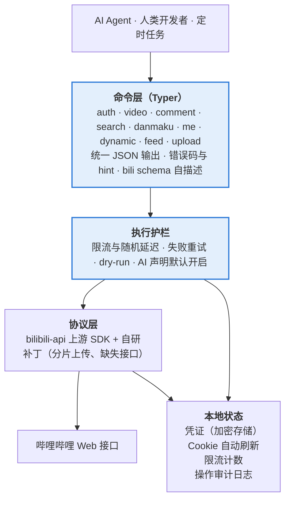
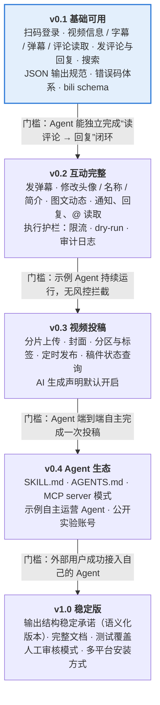

# bili-cli 项目策划案

2026-10-20

## 项目概述

bili-cli 是一个开源的哔哩哔哩命令行工具。它首先是写给 AI Agent 用的：把这个 CLI 交给一个 Agent，Agent 就能自主运营一个 B 站账号。

**一句话定位**：B 站账号的 Agent 操作层。扫码登录之后，看视频、评论、回复、发弹幕、改资料、发动态、投稿都可以通过一条命令完成。

**为什么是 CLI，而不是 GUI 自动化或纯 SDK**

- Agent 天生会读 `--help`、拼命令、解析输出。CLI 比浏览器自动化稳定得多，也省 token。
- 任何能执行 shell 的 Agent 框架都能直接用，比如 Claude Code、Codex、OpenHands、自建 Agent，不依赖特定协议。
- 人类开发者也能手动调试，同一条命令，人和 AI 的执行结果一致。

**愿景**：让一个 Agent 加一个 B 站账号就能组成完整的内容创作者，独立完成选题、发布、互动、复盘。

## 目标用户与核心场景

核心用户是搭建 AI Agent 的开发者，次要用户是想用脚本管理账号的个人 UP 主。

| 用户 | 诉求 | 典型用法 |
| --- | --- | --- |
| Agent 开发者 | 让 Agent 自主运营 B 站账号 | 把 CLI 和 SKILL.md 交给 Agent，由它自己规划和执行 |
| 个人 UP 主 | 省掉重复劳动 | 手动或定时任务中批量回复评论、定时发动态 |
| 研究者 / 数据分析 | 获取视频、字幕、弹幕、评论 | 用读取类命令导出 JSON |

**典型场景：Agent 的一天**

1. 人类用户首次执行 `bili auth login`，用手机扫码，凭证保存在本地。
2. Agent 执行 `bili feed notifications` 读取新的回复和 @，逐条生成回复并用 `bili comment reply` 发出。
3. Agent 用 `bili video subtitle` 和 `bili comment list` 阅读热门视频，形成选题。
4. Agent 调用外部工具制作视频，再用 `bili upload` 投稿，默认带 AI 生成声明。
5. Agent 用 `bili dynamic post` 发动态预告，第二天用 `bili video stats` 复盘数据。

## 竞品与现有生态

B 站协议层已经有成熟的开源实现，bili-cli 不重复造轮子，差异化放在“给 Agent 用的操作层”。

| 项目 | 类型 | 覆盖范围 | 对 Agent 的不足 |
| --- | --- | --- | --- |
| bilibili-API-collect | 接口文档 | 最全的非官方接口整理 | 只是文档，不能执行 |
| bilibili-api（Python） | SDK | 登录、评论、弹幕、动态、投稿基本齐全 | 需要写代码调用，Agent 不能直接用 |
| biliup / biliup-rs | 上传工具 | 视频投稿、直播录制上传 | 只管上传，没有互动功能 |
| 各类下载器（如 yt-dlp） | 下载工具 | 视频和字幕下载 | 只读，无登录后的写操作 |

**bili-cli 的差异化**

- **全功能闭环**：读、写、发布、互动、消息通知都在一个工具里。
- **Agent 优先的接口设计**：稳定 JSON、可理解的错误、无交互、自描述，详见下文“面向 Agent 的设计原则”。
- **内置安全护栏**：限流、AI 声明默认开启、只支持单账号，降低封号和滥用风险。

以上各项目的维护状态未经核实，立项前需逐一确认；也需要在 GitHub 上确认是否已有同定位的项目。

## 功能规划

功能分为 9 个命令组。第一优先级是登录和评论互动，投稿虽然最重要，但实现最复杂，放在 v0.3。

| 命令组 | 主要子命令 | 说明 | 版本 |
| --- | --- | --- | --- |
| `auth` | `login` `status` `logout` | 扫码登录，凭证持久化与自动刷新 | v0.1 |
| `video` | `info` `subtitle` `danmaku` `stats` `download` | 让 AI“看”视频：元数据、AI 字幕、弹幕、数据，可选音频和抽帧 | v0.1 |
| `comment` | `list` `post` `reply` `like` `delete` | 评论读取与互动，支持楼中楼 | v0.1 |
| `search` | `video` `user` | 搜索，用于选题和找对标 | v0.1 |
| `danmaku` | `send` | 按时间点发弹幕 | v0.2 |
| `me` | `show` `set-name` `set-sign` `set-avatar` | 查看和修改个人资料 | v0.2 |
| `dynamic` | `post` `list` `delete` | 发布文字 / 图文动态 | v0.2 |
| `feed` | `notifications` `replies` `mentions` `timeline` | 读取回复、@、关注动态，是自主运营闭环的关键 | v0.2 |
| `upload` | `video` `status` | 分片上传、封面、分区、标签、AI 声明、定时发布 | v0.3 |

**命令示例**

```bash
bili auth login --qr-out qr.png      # 输出二维码图片和 URL
bili auth status --wait 120          # 阻塞等待扫码完成
bili video subtitle BV1xx411c7mD     # 获取 AI 字幕
bili comment reply BV1xx411c7mD --rpid 123456 "谢谢支持"
bili danmaku send BV1xx411c7mD "前排" --time 12.5
bili dynamic post "今天的新视频" --image a.png --image b.png
bili upload video demo.mp4 --title "标题" --tid 201 --tag AI --cover c.jpg
```

“看视频”对 AI 的含义不是播放，而是拿到能理解的文本：标题、简介、字幕、弹幕和热评。多模态模型可以再用 `--frames` 抽帧。

## 面向 Agent 的设计原则

每条命令都要让 Agent 不看源码、不问人就能用对。这是 bili-cli 和其他工具的核心区别。

1. **结构化输出**：标准输出不是终端时默认输出 JSON；`--json` / `--pretty` 可以强制切换。字段名稳定，变更走语义化版本。
2. **统一的返回结构**：成功返回 `{"ok": true, "data": ...}`；失败返回 `{"ok": false, "error": {"code", "message", "hint"}}`。`hint` 直接告诉 Agent 下一步该做什么，例如“请运行 bili auth login”。
3. **错误码分类与退出码**：未登录、凭证过期、风控拦截、触发验证码、限流、参数错误、资源不存在，分别对应不同的错误码和进程退出码，Agent 可以据此决定重试、等待还是求助人类。
4. **零交互**：不弹确认提示，不读 stdin（除非显式 `-`），所有参数都能通过 flag 传入。
5. **扫码登录两步走**：AI 扫不了码，所以 `auth login` 只负责输出二维码（终端字符画 + PNG 文件 + URL）后立即返回；`auth status --wait` 阻塞等待人类扫码。Agent 可以把二维码图片转发给人类。
6. **安全演练**：所有写操作支持 `--dry-run`，只打印将要发出的请求，不真正执行。
7. **自描述**：`bili schema` 输出所有命令、参数和返回结构的 JSON Schema；仓库附带 `SKILL.md` 和 `AGENTS.md`，Agent 读完就能上手。
8. **长文本友好**：评论、动态正文支持 `--file` 读取，避免 shell 转义问题；长列表支持 `--limit` 和游标分页，防止输出撑爆上下文。

## 技术方案

第一版用 Python 实现，协议层复用 bilibili-api，把精力集中在命令层和执行护栏上。



bili-cli 自研上面两层（蓝色），协议层复用开源 SDK。调用方只接触命令层；每个写操作都要先经过执行护栏，再由协议层发出请求。

**语言选型**

| 方案 | 优点 | 缺点 | 结论 |
| --- | --- | --- | --- |
| Python + Typer + bilibili-api | 协议层现成，MVP 最快；协议变动由上游跟进 | 用户需要 Python 环境；启动稍慢 | 采用 |
| Go / Rust 单二进制 | 零依赖分发，启动快 | 上传、wbi 签名等协议要全部自研，工作量大数倍 | 有用户基础后再评估 |

**关键实现点**

- **分发**：发布到 PyPI，推荐 `uv tool install bili-cli` 或 `pipx install bili-cli`，一条命令就能装好。
- **凭证**：保存在用户配置目录（如 `~/.config/bili-cli/`），文件权限设为仅本人可读，可选接入系统 keyring；`refresh_token` 用于自动续期 Cookie。
- **限流**：按操作类型分别设置令牌桶（评论、弹幕、动态、投稿各自独立），并加入随机抖动；默认值需要实测后确定，用户可以调低，不建议调高。
- **异步**：bilibili-api 是异步库，命令层统一用 `asyncio.run` 包装，对调用方保持同步语义。
- **测试**：协议层用录制回放（如 VCR）做离线测试，另设一个需要真实账号的手动冒烟测试集。

## 风险与合规

最大的风险不在技术，而在平台风控和合规。护栏要从第一天就设计进去，不能事后补。

| 风险 | 影响 | 应对 |
| --- | --- | --- |
| 平台风控（-352 / -412、wbi 签名、buvid 校验） | 请求被拒，功能失效 | 跟进上游 SDK；风控拦截返回明确错误码，而不是静默失败 |
| 验证码（新号评论常见极验验证） | Agent 无法继续 | 返回 `captcha_required` 错误和验证链接，交给人类处理；不接入打码平台 |
| 账号封禁 | 用户损失账号 | 默认保守限流；README 明确风险由用户自担；建议用已正常使用过的老账号（新注册账号风控最严，实测一上来就被风控） |
| 非官方接口的法律风险 | 项目可能收到平台投诉 | 只做单账号个人使用场景；不提供刷量、批量注册、爬取他人隐私等功能 |
| AI 生成内容标识 | 《人工智能生成合成内容标识办法》2025 年 9 月起施行，未标识可能违规 | 投稿默认勾选“AI 生成”声明，关闭需要显式传 `--no-ai-declare` |
| Agent 失控（刷屏、不当言论） | 账号和项目声誉受损 | 限流硬上限、操作审计日志、可选的“人工审核模式”（写操作先进队列，确认后发出） |
| 凭证泄露 | 账号被盗 | 凭证加密存储，文件权限收紧；日志和错误输出中不打印 Cookie |

这些限制也是项目的定位：它帮一个真实的创作者把账号交给 AI 打理，而不是做营销号工厂。

## 路线图与里程碑

从登录和评论互动起步，第三步做投稿，第四步做 Agent 生态。每个版本过了门槛才进入下一阶段，具体日期待定。



v0.1 是下一步要做的版本；投稿放在 v0.3，是因为它依赖 v0.2 的执行护栏。

## 开源运营与推广

传播的核心卖点是一个可以亲眼看到的 demo：一个完全由 AI 运营的 B 站账号。

- **许可证**：MIT。如果上游 bilibili-api 的许可证对依赖方有要求，以其为准（待核实）。
- **文档**：中文 README 为主、英文 README 为辅；必须包含风险声明和使用规范。
- **Agent 接入包**：`SKILL.md`（Claude Code 等技能格式）、`AGENTS.md`、可选的 MCP server 模式，一键接入主流 Agent 框架。
- **示例 Agent**：仓库自带一个最小的自主运营 Agent，演示“读通知 → 回复 → 发动态”的循环。
- **实验账号**：开一个公开声明“由 AI 运营”的 B 站账号，把运营过程本身做成内容；这是最有说服力的宣传。
- **渠道**：GitHub、B 站自身、V2EX、即刻、少数派、X；英文社区介绍时突出“AI Agent 运营中文视频平台”这一点。
- **社区协作**：按命令组拆 good first issue；接口失效有专门的 issue 模板，方便快速反馈和修复。

## 待决策事项

下面几项定下来之后，就可以开始搭建 v0.1 骨架。

- [ ] 投稿是按计划放在 v0.3，还是提前到 v0.1
- [ ] 项目名和命令名：`bili-cli`（命令 `bili`）还是 `bilictl`；需要先查 PyPI 和 GitHub 是否重名
- [ ] 确认 Python + bilibili-api 方案，并核实上游的维护状态和许可证
- [ ] 是否在 v0.1 就提供 MCP server 模式，还是先只做 CLI + SKILL.md
- [ ] “人工审核模式”是否默认开启
- [ ] 用于开发测试和公开演示的 B 站账号如何准备
- [ ] 抽帧和音频处理是否依赖 ffmpeg，还是作为可选依赖
